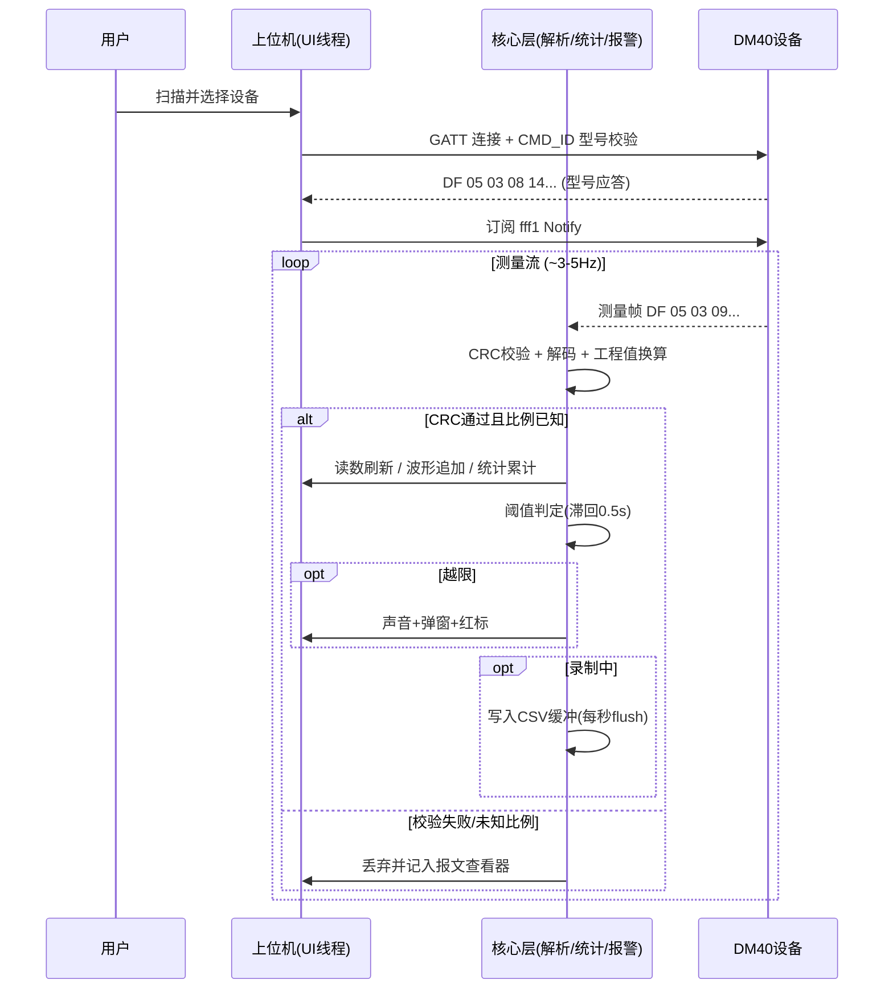
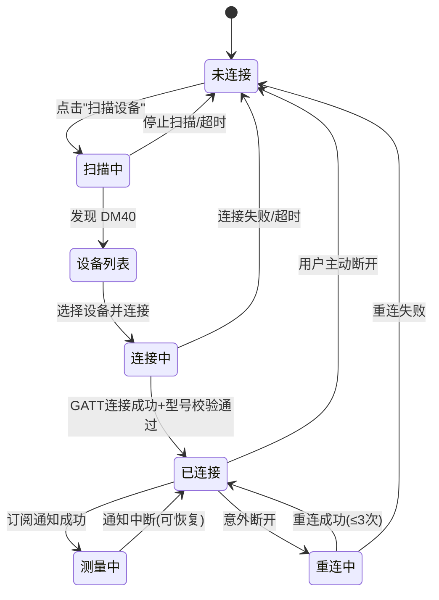
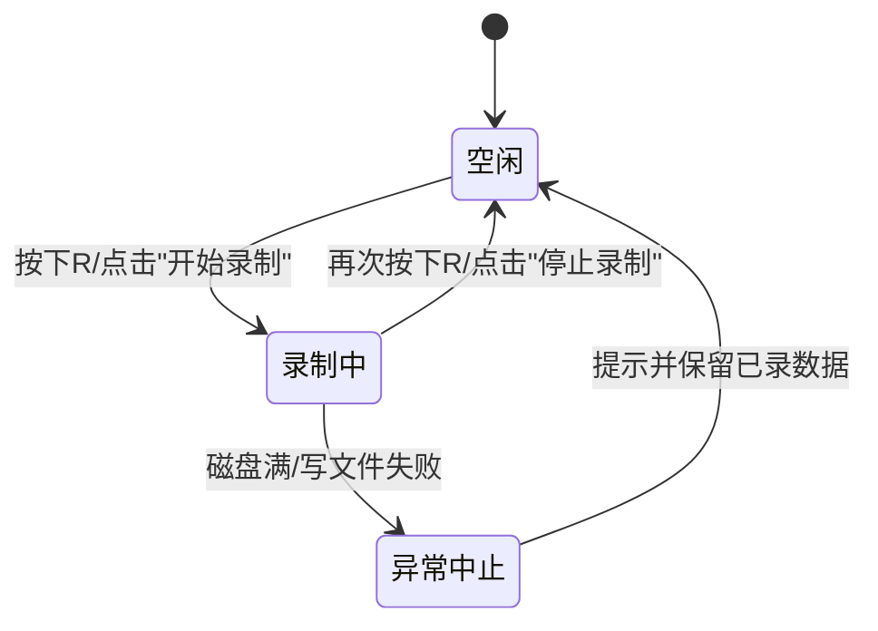

# DM40 万用表 PC 上位机 需求规格说明书 (PRD)

**生成时间**: 2026-07-17
**文档状态**: 草稿/待评审 (由 /prd2html 指令按 v3 规范自动生成)
**项目代号**: DM40Meter Studio
**目标平台**: Windows 桌面端 / .NET Framework 4.8 / WPF + WebView2(ECharts 波形)

---

## 1 文档状态

| 项目 | 状态 |
| :--- | :--- |
| 文档类型 | 桌面单机软件产品需求规格说明书（PRD） |
| 系统需求关键产物 | PRD 文档 + 交互式高保真 HTML 原型（已生成） |
| 正式输出条件 | 通过产品评审并完成 R-02（BLE 传输层技术验证 Spike）后可进入开发 |
| 产物验证口径 | 机器校验通过或所属层级交接摘要覆盖，均可 |

### 1.1 版本修订历史

| 版本号 | 修订人 | 修订时间 | 修改内容 | 状态 |
|---|---|---|---|---|
| V0.1 | AI 产品架构师 | 2026-07-17 | 按 v2 规范生成首版 PRD | 已废弃 |
| V0.2 | AI 产品架构师 | 2026-07-17 | 按 v3 规范重构：15 章固定子节、FR 模块级 7 字段结构 | 已废弃 |
| V0.3 | AI 产品架构师 | 2026-07-17 | 修正原型歧义：明确左侧导航为 PRD 预览翻页工具（非软件界面），中间区域还原为完整 PC 桌面应用窗口（窗口标题栏 + 应用内页签 + 模态设置对话框）；同步修订 7.1/7.2 布局与流转说明 | 已废弃 |
| V0.4 | AI 产品架构师 | 2026-07-17 | 原型升级为页面流程画布：全部视图平铺于可平移/缩放的无限画布，视图跳转关系以箭头曲线直接标注，增加 L1/L2 层级标签；同步修订 7.1/7.2/7.3；v3 规范 3.1.0 增加"切换/画布"两种呈现模式约定 | 已废弃 |
| V0.5 | AI 产品架构师 | 2026-07-17 | 新增需求：应用支持 **CLI 无头模式**（`--cli`），将设备接入 AI 做自动化测试。新增 §6.7 FR-014（CLI 四命令：scan/stream/send/record）、JSON Lines/CSV 双格式、退出码；§4.1/§9/§12/§13 同步更新。实现状态：✅ 已实现（模拟源端到端通过，BLE 源待 Windows SDK）。详见 `docs/CLI_Contract.md` | 草稿 |
| V0.6 | Claude Code | 2026-07-20 | ① **真机 BLE 端到端打通（DM40B）**：移除全部模拟源，生产代码默认连真机；读数 5.0029V 与表显逐位一致（AC-01 达标）。② **UI 1:1 复刻原型**：自定义标题栏 + 设备工具条 + 三栏布局（读数+设备控制 / 三页签波形 / 统计+阈值）+ 状态栏，深色靛蓝主题、读数辉光、电量徽章。③ **波形交互完整**：钉点、拖框选 Min/Max/Δ、越限红点、中键平移/右键滚轮缩放/双击恢复、P 暂停、时间窗口可配（30s/60s/5min/10min）。④ **数据回放完整**（FR-010）：打开 CSV、播放/暂停/停止、0.5–10x 倍速、进度条、与实时互斥。⑤ **协议校正**：17 字节测量帧、相对帧尾索引、DM40 全系 60000 counts。AC-04/05/07 离线验证改为 FakeMeterSource 注入真实抓取帧字节。CLI `--source` 废弃（恒连真机）。 | 已实现 |
| V0.7 | Claude Code | 2026-07-22 | ① **波形渲染迁移 ScottPlot→ECharts 5.5/WebView2**：本地嵌入 `echarts.min.js`（离线单文件 `NavigateToString`），交互全用 ECharts 默认控件（tooltip/滚轮缩放/底部缩略条/拖拽框选缩放/双击还原）；实时 X 轴固定 `[-win,0]` 防抖；上下限 markLine 标注联动报警。② **时间窗口自定义**：快捷 30/60/300/600s + 自定义秒数(≥5s)；波形缓冲固定 100 万点。③ **上下限小数输入修复**（字符串字段缓存防 round-trip）。④ **报文页工具**：查找(Ctrl+F,输入即搜,Enter/Shift+Enter/Esc)、暂停滚动(暂停时停止插入)、清空、CRC 失败计数、底部状态。⑤ **设备控制**：保持按钮失同步修复（双向跟随 `m.Hold` 回读）；锁定项移除（协议无锁定命令，仅只读徽章）。⑥ **一键截图**：工具条按钮 + Ctrl+P，PNG 自动存可配目录(默认 图片\DM40MeterStudio)，提示含"打开位置"。⑦ **扫描自动连接第一个设备**(1.2s 窗口，设置可关)。⑧ 修复 CollectionChanged 重入崩溃（滚动/选中一律 BeginInvoke 延迟）。⑨ 主读数/单位字体 52/26，y 轴疏朗青色刻度参考设备 UI。复盘见 `docs/superpowers/specs/2026-07-22-echarts-waveform-retro.md` | 已实现 |

---

## 2 产品概述

### 2.1 背景与问题

DM40 系列数字万用表自带小尺寸屏幕，内置蓝牙 BLE 模块并以固定协议持续推送测量数据帧。开源社区已有 Python/Tkinter 实现（maj113/DM40GUI）验证了协议可行性，但存在明显短板。用户面临的核心痛点：

1. **读数观测难**：长时间监测电压/电流/温度变化时需一直盯小屏，易疲劳、易漏异常。
2. **无数据留存**：设备本身不能记录历史数据，无法事后追溯与分析。
3. **无趋势可视化**：缺乏波形图，无法直观看到信号波动趋势与突变。
4. **无越限提醒**：监测电源稳定性等场景下，超出阈值无法及时感知。
5. **现有工具体验差**：开源方案为英文 Tkinter 界面，风格陈旧，无统计/报警/回放能力，不符合国内用户习惯。

### 2.2 产品目标

打造一款面向国内硬件工程师与电子爱好者的 DM40 万用表 Windows 端专业配套软件（单机免费工具），实现：

- 一块大屏看清全部测量状态（主读数 + 辅助读数 + 设备状态）；
- 实时波形 + 测量统计，让信号趋势一目了然；
- 阈值报警 + CSV 录制 + 数据回放，覆盖"监测—记录—复盘"完整工作流；
- 现代化中文界面，深浅色跟随系统，零学习成本。

### 2.3 成功指标

| 指标 | 目标值 | 度量方式 |
|---|---|---|
| 读数一致性 | 与万用表实体读数逐位一致（同单位下误差 0） | 对比测试 |
| 连接建立时间 | ≤ 5s | 计时埋点/实测 |
| 波形滚动帧率 | ≥ 25 fps（60s 窗口满数据） | 帧率计数 |
| 报警触发延迟 | ≤ 1s（越限到提醒） | 注入测试 |
| 长时间稳定性 | 连续录制 8h 内存增长 ≤ 50MB，文件完整 | 稳定性测试 |
| 崩溃率 | 解析任意畸形帧 0 崩溃 | 模糊测试 |

---

## 3 用户角色与场景

### 3.1 用户角色

| 角色 | 画像描述 | 技术水平 | 使用频率 |
|---|---|---|---|
| 张工（硬件研发工程师） | 32 岁，消费电子公司硬件工程师，日常调试电源、信号完整性 | 高（熟悉串口/BLE 调试工具） | 每日 |
| 李同学（电子专业学生/爱好者） | 22 岁，实验室做课程设计、DIY 项目 | 中 | 每周数次 |
| 王老师（维修/质检技师） | 40 岁，产线抽检与售后维修，需要留存测量记录 | 中低 | 每日 |

### 3.2 核心场景

**场景 A：电源稳定性长时间监测（张工）**
连接 DM40 → 观察 3.3V 电源 2 小时波动 → 设定 3.135V~3.465V（±5%）阈值 → 越限声音+弹窗报警 → 全程 CSV 录制 → 事后导出分析。

**场景 B：元器件快速测量（李同学）**
在 PC 上一键切换电容/二极管/通断档位 → 大屏直接读数 → Ctrl+C 复制读数贴到实验报告。

**场景 C：产线抽检留痕（王老师）**
每次抽检一键保存 CSV（按时间自动命名归档）→ 可疑批次用回放功能复盘波形 → 定位异常时刻。

### 3.3 用户场景范围

- **范围内**：单机、单设备、本机文件系统内的全部测量—监测—记录—复盘操作。
- **边界一**：不支持多设备并行监测；不支持多用户协同。
- **边界二**：数据仅保存在本机，不上传云端、不跨机器同步。
- **边界三**：仅 DM40 系列万用表；EL15 电子负载等其他设备不在用户场景内。

---

## 4 范围边界

### 4.1 本期范围

- DM40 的 BLE 扫描、连接、断开与自动重连。
- 实时测量数据显示（主读数、辅助读数、模式、量程、电池、充电、锁定、Hold 状态）。
- 设备远程控制：Hold、自动量程、相对值（REL）、电容/二极管/通断/频率/温度档位切换。
- 实时滚动波形：暂停/恢复、点击标记、框选区间统计（Min/Max/Δ）。
- 测量统计面板：Min / Max / Avg / Δ / 样本数 / 时长。
- 阈值报警：上下限设置、越限声音与弹窗提醒、报警事件列表。
- CSV 一次性导出与连续录制。
- 录制文件波形回放（变速回放、进度拖动）。
- 原始报文查看器（HEX 显示、CRC 校验标签、关键字查找）。
- 深浅色主题（默认跟随系统）、中文界面、全局快捷键。
- **CLI 无头模式（FR-014）**：`--cli` 进入无头模式，支持 scan/stream/send/record 四命令，JSON Lines/CSV 双格式输出到 stdout，供 AI 与自动化脚本消费（见 §6.7、`docs/CLI_Contract.md`）。

### 4.2 不包含范围

- EL15 电子负载及其他设备的支持（协议层预留扩展点，二期评估）。
- 串口/USB 有线连接方式。
- 多设备同时连接。
- 用户账户体系、云端同步、数据上传服务器。
- Linux / macOS 平台。
- 固件升级（OTA）功能。
- 移动端 App。

### 4.3 外部依赖

| 依赖项 | 类型 | 说明 |
|---|---|---|
| DM40 设备 BLE GATT 接口 | 硬件外部接口 | 唯一外部数据契约（详见 11.2） |
| Windows BLE 协议栈 | 操作系统服务 | Windows 10 1703+ 的 WinRT `Windows.Devices.Bluetooth` API |
| .NET Framework 4.8 运行时 | 运行时依赖 | Win10 1903+ 预装 |
| Microsoft.Web.WebView2 | 第三方组件 | 内嵌 Edge WebView2 渲染波形页（本地嵌入 echarts.min.js，离线可用） |
| ECharts 5.5（图表库） | 第三方开源库 | 实时波形渲染（V0.7 由 ScottPlot 迁入）；ScottPlot 4.1 保留为兜底 |

---

## 5 业务规则与业务模型结论

### 5.1 核心业务流程

测量数据主链路时序图：



### 5.2 关键业务规则

1. **帧有效性规则**：测量帧必须满足长度校验 + CRC（全帧字节和 `& 0xFF == 0`）；无效帧不参与显示、统计、报警与录制。
2. **工程值换算规则**：显示值 = 原始计数 × 比例系数 × 符号；比例系数由比例槽位字节查表（scale map）获得，查表失败按未知帧处理。
3. **统计口径规则**：统计对象为当前统计窗口内全部有效主读数工程值；清零后自下一帧重新累计。
4. **报警判定规则**：主读数 > 上限或 < 下限为越限；带 0.5s 滞回；同方向越限在恢复前不重复弹窗；上限必须大于下限。
5. **录制落盘规则**：录制采用内存队列缓冲，每秒 flush 一次；写失败立即停止录制并保留已录数据。
6. **命令下发规则**：命令帧 6 字节，校验和 `(-sum(前5字节)) & 0xFF` 由协议层统一计算；UI 状态以设备回帧为准，不以本地乐观值为准。

### 5.3 状态与异常处理

**连接状态机：**



**录制状态机：**



**全局异常兜底方案：**

| 异常类别 | 兜底策略 |
|---|---|
| 蓝牙适配器不可用 | 禁用扫描按钮，提示"请检查蓝牙开关/驱动" |
| 连接中断 | 读数/波形区覆盖"连接中断"蒙层，不清空已有数据，自动重连 ≤3 次（2s/5s/10s 退避） |
| 未知比例/量程帧 | 显示 `---`，原始帧留痕报文查看器，绝不抛异常到 UI |
| 连续 2s 无数据帧 | 显示"信号停滞"提示 |
| 磁盘写入失败 | 停止录制，保留已录数据，明确提示 |
| 未捕获异常 | 全局兜底捕获 + 友好提示 + 写日志，进程不崩溃 |

### 5.4 业务数据口径

| 名词 | 定义 / 计算公式 |
|---|---|
| 工程值 | `原始计数 × 比例系数 × 符号`，单位随模式确定（V/A/Ω/F/Hz/℃） |
| 样本 | 一帧 CRC 校验通过且比例已知的测量帧解码结果 |
| 平均值 Avg | `Σ(有效工程值) / 有效样本数` |
| Δ（峰峰值） | `Max − Min`（当前统计窗口内） |
| 越限 | `工程值 > 上限 或 工程值 < 下限`，持续判定带 0.5s 滞回 |
| 统计窗口 | 默认本次连接以来全部样本，"清零重计"后自下一帧起算 |
| 波形缓冲 | 内存上限 100 万样本点，超出丢弃最旧 |
| 报文缓冲 | 内存上限 10000 帧，循环覆盖 |

---

## 6 功能需求

### 6.1 设备连接管理模块

#### 6.1.1 FR-001 设备扫描

- **使用角色**：张工、李同学、王老师（所有用户）。
- **业务目的**：发现周边广播中的 DM40 设备，是建立通信链路的第一步。
- **前置条件**：PC 蓝牙已开启；DM40 已开机并处于广播状态；Windows 10 1703+。
- **功能说明**：点击工具栏"扫描设备"开始 BLE 扫描（默认 10s，可中途停止）；结果列表展示设备名、MAC 地址、信号强度 RSSI；默认仅显示名称匹配 DM40 前缀的设备，提供"显示全部 BLE 设备"调试开关。
- **规则约束**：扫描中不可重复发起扫描、不可发起连接；列表按 RSSI 降序排列。
- **异常处理**：蓝牙适配器不可用时禁用扫描按钮并提示；扫描超时无结果时提示"未发现设备，请确认 DM40 已开机"。
- **数据要求**：扫描动作记入运行日志（时间戳、发现设备数）。

#### 6.1.2 FR-002 设备连接与自动重连

- **使用角色**：所有用户。
- **业务目的**：建立并维持稳定的 GATT 通信链路，是所有后续功能的基础。
- **前置条件**：扫描列表中存在目标设备。
- **功能说明**：选择设备点击"连接"，GATT 连接成功后发送 `CMD_ID` 校验型号（收到 `DF 05 03 08 14` 前缀应答视为 DM40）；校验通过后订阅 Notify 特征 `fff1` 进入"测量中"；意外断开时自动重连最多 3 次（2s/5s/10s 退避），均失败回到未连接态并提示。
- **规则约束**：同一时间仅允许一个设备会话；连接操作 15s 超时；重连期间不清空已有波形与统计数据。
- **异常处理**：连接超时给出重试入口；重连期间读数/波形区显示"连接中断"蒙层；型号校验失败提示"非 DM40 设备"并断开。
- **数据要求**：最近连接成功的设备 MAC 持久化到本地配置（支持一键重连）；连接/断开/重连事件写入运行日志。

### 6.2 实时测量模块

#### 6.2.1 FR-003 实时读数显示

- **使用角色**：所有用户。
- **业务目的**：以大屏高对比度呈现测量值与设备状态，替代盯小屏。
- **前置条件**：设备处于"测量中"状态。
- **功能说明**：主读数区超大字号显示主测量值+单位+模式标识（DCV/ACV/Ω/电容/频率/温度等）；辅助读数区显示 m2/m3 解码值；状态图标行显示量程（AUTO/手动档位）、电池电量（0-5 格）、充电中、屏幕锁定、Hold、REL；刷新频率跟随设备推送（约 3~5Hz），UI 做节流合并防闪烁。
- **规则约束**：数值解析严格按协议字节布局（`data[14:16]` 主值小端、比例/符号槽位 `data[-8]` 等）；未知比例标志显示 `---` 并保留原始帧。
- **异常处理**：CRC 失败帧丢弃（仅入报文查看器）；连续 2s 无数据帧显示"信号停滞"。
- **数据要求**：显示值不落库；解析失败原始帧保留在报文缓冲（上限 10000 帧循环覆盖）。

#### 6.2.2 FR-004 设备远程控制

- **使用角色**：张工、李同学。
- **业务目的**：在 PC 端完成常用档位/功能切换，减少低头操作万用表。
- **前置条件**：设备已连接。
- **功能说明**：控制条提供 8 个按钮，点击发送 6 字节命令帧（`AF 05 03 <cmd> <arg> <checksum>`）：Hold 开/关（`04 01 01/00`）、自动量程开/关（`03 01 01/00`）、REL 相对值（`05 01 01`）、电容（`06 01 03`）、二极管（`06 01 04`）、通断（`06 01 44`）、频率（`06 01 05`）、温度（`06 01 45`）。
- **规则约束**：校验和 `(-sum(前5字节)) & 0xFF` 由协议层统一计算；按钮发送后 500ms 防重复点击锁；UI 状态以设备回帧为准。
- **异常处理**：写特征失败提示"命令发送失败"并允许重试；连接中断时控制条整体禁用。
- **数据要求**：每条下发命令记入运行日志（时间戳+HEX）。

### 6.3 波形与统计模块

#### 6.3.1 FR-005 实时波形显示

- **使用角色**：所有用户。
- **业务目的**：将测量流转为趋势曲线，直观发现波动与突变。
- **前置条件**：设备处于"测量中"。
- **功能说明**：ECharts 5.5（WebView2）滚动波形，X 轴时间窗口默认 60s（快捷 30s/5min/10min + 自定义秒数），Y 轴自适应；交互全用 ECharts 默认控件——滚轮缩放、底部缩略条平移/选区、拖拽框选缩放、双击还原；`P` 暂停/恢复滚动（暂停时数据继续缓存）；上下限以虚线 markLine 标注（联动 FR-007）。（V0.7 由 ScottPlot 迁入）
- **规则约束**：内存缓冲上限 100 万点，超出丢弃最旧并提示；暂停不影响录制。
- **异常处理**：断连期间曲线断点显示（不连线），恢复后继续绘制。
- **数据要求**：波形缓冲即 CSV 导出的数据源。

#### 6.3.2 FR-006 测量统计面板

- **使用角色**：张工、王老师。
- **业务目的**：给出监测窗口的量化概览，替代人工心算。
- **前置条件**：存在有效测量样本。
- **功能说明**：统计卡片实时显示最小值、最大值、平均值、Δ（Max−Min）、样本数、统计时长；提供"清零重计"按钮；统计基于主读数工程值。
- **规则约束**：统计窗口默认本次连接以来全部样本；清零后从下一帧重新累计；无效帧不计入。
- **异常处理**：无样本时显示 `--`。
- **数据要求**：清零操作记入运行日志。

### 6.4 报警模块

#### 6.4.1 FR-007 阈值报警

- **使用角色**：张工（监测场景）、王老师（抽检场景）。
- **业务目的**：越限主动提醒，解放人力盯屏。
- **前置条件**：设备处于"测量中"。
- **功能说明**：报警设置区提供启用开关、上限值、下限值（输入带单位）、声音开关、弹窗开关；越限判定带 0.5s 滞回；触发方式为系统提示音（可配置仅一次/循环）+ 非模态弹窗（越限值、方向、时间）+ 波形区段红标 + 读数区红色脉冲边框；报警事件列表保留最近 100 条（时间、方向、值）。
- **规则约束**：上限必须大于下限，保存时校验；阈值输入精度跟随当前档位显示精度；留空表示该方向不判定。
- **异常处理**：同方向越限恢复前不重复弹窗；弹窗最多堆叠 3 条。
- **数据要求**：报警事件写入运行日志；阈值配置持久化到本地配置文件。

### 6.5 数据管理模块

#### 6.5.1 FR-008 CSV 一次性导出

- **使用角色**：所有用户。
- **业务目的**：将当前监测缓冲快速留存，用于报告与分享。
- **前置条件**：波形缓冲区非空。
- **功能说明**：`Ctrl+S` 或"导出 CSV"按钮将当前波形缓冲一次性保存为 CSV（用户选路径）；默认文件名 `DM40_yyyyMMdd_HHmmss.csv`；列定义见 9.1。
- **规则约束**：文件使用 UTF-8 带 BOM 编码，保证 Excel 直接打开不乱码。
- **异常处理**：目标文件被占用时提示换名；缓冲为空时按钮禁用。
- **数据要求**：导出动作记入运行日志（路径、行数）。

#### 6.5.2 FR-009 CSV 连续录制

- **使用角色**：所有用户。
- **业务目的**：长时间无人值守记录测量数据。
- **前置条件**：设备处于"测量中"。
- **功能说明**：`R` 或"开始录制"启动持续追加写入 CSV，再次触发停止；录制中状态栏显示红点呼吸 + 已录时长 + 样本数；内存队列缓冲每秒 flush 落盘。
- **规则约束**：录制文件格式与导出一致（可被回放模块解析）；默认文件名规则同 FR-008。
- **异常处理**：磁盘满/写入失败时停止录制、保留已录数据并明确提示。
- **数据要求**：录制启停与异常事件记入运行日志。

#### 6.5.3 FR-010 数据回放

- **使用角色**：张工、王老师。
- **业务目的**：复盘历史测量过程，定位异常时刻。
- **前置条件**：存在本软件生成的 CSV 文件。
- **功能说明**："打开回放"选择 CSV 后进入回放模式（与实时模式互斥，进入前提示保存当前数据）；支持播放/暂停、进度条拖动、倍速 0.5x/1x/2x/4x/10x；回放中读数区、波形区、统计区按文件数据联动刷新，越限标记同步显示。
- **规则约束**：回放模式禁用设备控制条与录制按钮；文件超过 100 万行时提示"仅加载前 100 万行"。
- **异常处理**：文件格式非法（列缺失/时间戳解析失败）时给出明确错误提示，不进入回放。
- **数据要求**：回放不产生任何新数据落盘。

### 6.6 诊断与个性化模块

#### 6.6.1 FR-011 原始报文查看器

- **使用角色**：张工（协议调试）、开发排障。
- **业务目的**：暴露原始通信帧，支撑协议问题定位与未知帧上报。
- **前置条件**：设备已连接。
- **功能说明**：独立视图滚动显示收发报文：方向（RX/TX）、时间戳、HEX 内容、CRC 校验通过/失败内联标签；`Ctrl+F` 打开查找框，`Enter`/`F3` 下一个，`Shift+Enter`/`Shift+F3` 上一个，`Esc` 关闭；支持暂停滚动、一键清空、复制选中行。
- **规则约束**：缓冲上限 10000 帧循环覆盖；CRC 规则为全帧字节和 `& 0xFF == 0`。
- **异常处理**：无。
- **数据要求**：仅内存保留，不落盘（命令日志除外）。

#### 6.6.2 FR-012 主题与个性化

- **使用角色**：所有用户。
- **业务目的**：现代化观感，适应不同光线环境。
- **前置条件**：无。
- **功能说明**：深浅色主题默认跟随 Windows 系统设置，可手动锁定深色/浅色；主题切换即时生效并持久化；主色调为科技蓝（`#4F46E5` 系）。
- **规则约束**：跟随系统时监听系统主题变更事件动态切换。
- **异常处理**：系统主题读取失败时回退浅色。
- **数据要求**：主题偏好持久化到本地配置文件。

#### 6.6.3 FR-013 全局快捷键

- **使用角色**：所有用户。
- **业务目的**：提升高频操作效率。
- **前置条件**：应用处于前台。
- **功能说明**：`P` 暂停/恢复波形；`R` 开始/停止录制；`Ctrl+S` 导出 CSV；`Ctrl+C` 复制当前读数；报文视图内 `Ctrl+F`/`Enter`/`F3`/`Esc` 查找导航。
- **规则约束**：输入框聚焦时单键快捷键（P/R）不生效，避免误触。
- **异常处理**：无。
- **数据要求**：无。

### 6.7 CLI 无头模式模块（AI/自动化接入）

> 新增于 V0.5。实现状态：✅ 已实现（模拟源端到端通过）。完整对外契约见 `docs/CLI_Contract.md`。

#### 6.7.1 FR-014 CLI 命令行输出

- **使用角色**：AI 智能体、自动化测试脚本、DevOps 工程师（张工延伸场景）。
- **业务目的**：让设备能力可被程序化消费——无需 GUI 即可完成"发现→读数→控制→录制"全流程，用于将 DM40 接入 AI 做自动化测试与数据分析。
- **前置条件**：终端环境；CLI 数据源可用（`--source sim` 无需真机；`--source ble` 需 Windows SDK + 蓝牙 + 真机）。
- **功能说明**：`DM40MeterStudio.exe --cli <command> [options]` 进入无头模式（不带 `--cli` 仍为 WPF 界面）。
  - **scan**：扫描并列出 DM40 设备（名称/MAC/RSSI）。
  - **stream**：连接设备并持续输出测量帧（约 4Hz），到 `--duration` 或 Ctrl+C 停止。
  - **send**：下发一条命令（hold/auto/rel/档位切换）后退出。
  - **record**：录制测量数据到 CSV 文件（UTF-8 带 BOM，复用 §9.1 列）。
  - 全局选项：`--source sim|ble`（默认 ble）、`--format json|csv`（默认 json）、`--mac <地址>`、`--duration <秒>`（0=持续）；stream 可带 `--upper/--lower` 输出越限标记。
- **规则约束**：数据走 **stdout**，日志/诊断走 **stderr**（不污染数据流，便于管道与 AI 解析）；JSON Lines 每行一条对象，CSV 首行表头；退出码 0 成功 / 1 参数错误 / 2 未发现设备 / 3 连接失败 / 4 命令发送失败 / 5 录制写入失败。
- **异常处理**：参数错误 stderr 提示并返回 1；无设备/连接失败/写失败返回对应码且不崩溃；`stream` 持续模式下 Ctrl+C 由宿主处理。
- **数据要求**：`stream`/`scan` 不落盘（除非管道重定向）；`record` 落盘 CSV 并输出 `{"recorded":N,"path":"..."}` 摘要到 stdout。

#### 6.7.2 CLI 输出 JSON schema（stream）

```json
{"ts":"2026-07-17T14:30:25.123","value":3.3012,"unit":"V","mode":"VDC","range":"6V","overload":false,"alarm":null}
```

| 字段 | 类型 | 说明 |
|---|---|---|
| ts | string | ISO8601 本地时区毫秒精度 |
| value | number/null | 主读数工程值；过载为 null |
| unit | string | 单位（V/A/Ω/F/Hz/℃ 等） |
| mode | string | 测量模式（VDC/VAC/.../TEMP，同协议 Kind） |
| range | string | 量程 |
| overload | bool | 是否过载 |
| alarm | string/null | HIGH/LOW/null（需配 --upper/--lower） |

---

## 7 原型与交互说明

### 7.1 界面整体布局说明

原型（`prototypes/DM40Multimeter_prototype.html`）采用三栏结构，需明确区分"原型预览工具"与"软件本体界面"：

- **中间 UI 交互区（软件本体）**：以**无限画布（页面流程画布）**形式呈现——四个界面状态（实时监测主界面 / 原始报文页签 / 数据回放页签 / 设置对话框）全部平铺在可拖拽平移、可缩放的画布上，每个界面均为完整的 WPF 桌面应用窗口（带 Windows 窗口标题栏、最小化/最大化/关闭按钮、工具栏、状态栏）；画布上用带箭头的贝塞尔虚线标注视图间的跳转关系（蓝色=正向进入，灰色=退出返回），并以 `L1 主视图 / L2 页签视图 / L2 模态对话框` 标签标明层级。软件自身的导航（应用内页签、设置按钮）画在窗口内部。画布支持空白处拖拽平移、Ctrl+滚轮缩放、右上角缩放控件。
- **最左侧导航栏（sidebar-nav，原型预览工具）**：文档风格的视图导航，仅用于 PRD 评审时快速定位画布上的视图（点击平滑滚动定位并高亮闪烁），**不属于软件界面设计的一部分**。
- **最右侧说明栏（原型预览工具）**：与标注点一一对应的黄色 PRD 批注卡片，左右双栏独立滚动互不干扰。
- **SVG 全屏画布层**：贝塞尔虚线连接标注点与说明卡，滚动/缩放/切视图时实时重绘、永不漂移。

真实软件的导航结构：单主窗口 + 应用内三页签（实时波形/原始报文/数据回放）+ 模态设置对话框，无侧边栏导航。

### 7.2 核心页面流转图

```mermaid
flowchart LR
    A[实时波形页签] -->|点击应用内页签| B[原始报文页签]
    A -->|点击应用内页签| C[数据回放页签]
    A -->|点击设置按钮| D[设置对话框(模态)]
    B --> A
    C --> A
    D -->|保存/取消| A
    C -->|打开CSV| C1[回放中: 倍速/拖动]
    C1 -->|退出回放| A
```

软件为单主窗口结构：三个应用内页签无刷新切换；设置以模态对话框弹出；回放模式与实时模式互斥，进入回放前提示保存当前数据。原型中将该流转关系直接绘制在画布上（视图窗口间的箭头虚线），评审时无需切换即可纵览全部界面层级；通过最左侧"原型视图导航"可快速定位任一视图。

### 7.3 标注点交互说明

- 标注点（`anno-N`）为靛蓝色圆形数字 Badge，绝对定位在关键 UI 组件旁。
- 鼠标悬停标注点或其对应说明卡时：标注点变红放大、说明卡变红框高亮、两者间 SVG 连线由虚线变为红色实线加粗；移出后全部还原。
- SVG 连线起点为标注点右边缘中点，终点为说明卡左边缘中点，贝塞尔曲线平滑过渡。
- 画布平移、缩放及左右栏滚动均触发全量重绘，连线永不漂移；视图窗口间的跳转箭头绘制在画布内部 SVG 层，随画布同步平移缩放。

---

## 8 权限需求

### 8.1 功能权限矩阵

本产品为单机免费工具，无账户体系，仅存在"本机用户"一个角色：

| 功能菜单/按钮 | 本机用户 |
|---|:---:|
| 设备扫描/连接/断开 | ✓ |
| 实时读数/波形/统计 | ✓ |
| 设备远程控制（8 键） | ✓ |
| 阈值报警配置 | ✓ |
| CSV 导出/录制/回放 | ✓ |
| 原始报文查看器 | ✓ |
| 主题/快捷键 | ✓ |

### 8.2 数据权限控制

| 数据类别 | 可见范围 |
|---|---|
| 测量数据/CSV 文件 | 仅本机当前用户（存储于用户自选目录） |
| 配置文件 | 仅本机当前用户（`%AppData%/DM40MeterStudio`） |
| 运行日志 | 仅本机当前用户 |
| 系统级权限 | 依赖 Windows 蓝牙访问授权（系统弹窗）与目标目录 NTFS 写权限 |

---

## 9 数据需求

### 9.1 核心数据实体表

**表一：CSV 测量文件（录制/导出/回放共用格式）**

| 字段名 | 数据类型 | 必填 | 说明 |
|---|---|---|---|
| Timestamp | string (ISO8601 `yyyy-MM-dd HH:mm:ss.fff`) | 是 | 采样接收时刻（本地时区） |
| Value | double | 是 | 主读数工程值（已乘比例系数） |
| Unit | string | 是 | 单位：V/A/Ω/F/Hz/℃ 等 |
| Mode | string | 是 | 测量模式：DCV/ACV/DCA/ACA/RES/CAP/DIODE/CONT/HZ/TEMP |
| Range | string | 是 | 量程：AUTO 或具体档位 |
| Aux1 | double | 否 | 辅助读数 1（无则空） |
| Aux2 | double | 否 | 辅助读数 2（无则空） |
| Alarm | string | 否 | `HIGH`/`LOW`/空，越限方向标记 |

**表二：本地配置文件（`%AppData%/DM40MeterStudio/config.json`）**

| 字段名 | 数据类型 | 必填 | 说明 |
|---|---|---|---|
| theme | enum | 是 | `system`/`light`/`dark`，默认 `system` |
| lastDeviceMac | string | 否 | 最近连接设备 MAC，用于一键重连 |
| windowSeconds | int | 是 | 波形窗口时长，默认 60 |
| alarm | object | 是 | `{ enabled, upper, lower, sound, popup }` |
| csvDir | string | 否 | 默认导出目录 |

**表三：运行日志（`logs/app-yyyyMMdd.log`）**

| 字段名 | 数据类型 | 必填 | 说明 |
|---|---|---|---|
| ts | datetime | 是 | 事件时间戳 |
| level | enum | 是 | INFO/WARN/ERROR |
| category | string | 是 | CONN/CMD/PARSE/ALARM/REC/APP |
| message | string | 是 | 事件描述（命令含 HEX，异常含原始帧） |

### 9.2 数据归档与清理规则

| 数据 | 留存策略 |
|---|---|
| CSV 录制/导出文件 | 用户自行管理，应用不自动删除 |
| 内存波形缓冲 | 上限 100 万点，循环覆盖 |
| 报文缓冲 | 上限 10000 帧，循环覆盖 |
| 运行日志 | 单文件 10MB 滚动，最多保留 10 个，超出删除最旧 |
| 配置文件 | 长期保留；卸载应用不主动删除 `%AppData%` 数据 |
| 报警事件列表 | 内存保留最近 100 条，同时写日志持久留存 |

---

## 10 非功能需求

### 10.1 性能指标要求

| 指标 | 目标值 |
|---|---|
| 冷启动时间 | ≤ 3s（i5/8G/SSD 办公机） |
| 设备扫描出结果 | ≤ 10s |
| 连接建立 | ≤ 5s |
| 数据帧端到端延迟（接收到显示） | ≤ 200ms |
| 波形滚动帧率 | ≥ 25 fps（60s 窗口满数据，等效约 150 点/s 渲染吞吐） |
| 连续录制 8 小时 | 内存增长 ≤ 50MB，文件完整 |
| 报警触发延迟 | ≤ 1s |

### 10.2 安全性要求

- 无网络通信、无数据库，攻击面仅限本机 BLE 链路，不涉及传输加密与 SQL 注入问题。
- 设备输入为不可信数据：解析必须做长度与 CRC 校验，未知字段/畸形帧不得引发异常。
- 文件读写防路径遍历：导出/回放路径限定用户显式选择的目录。
- 不收集任何用户数据，无遥测上报。
- 第三方依赖（WebView2、ECharts、ScottPlot 兜底）使用官方 NuGet 正式版并锁定版本号。

### 10.3 兼容性与自适应

- 操作系统：Windows 10 1703 (15063) 及以上 64 位；兼容 Win10 1809/21H2/22H2、Win11 23H2。
- 运行时：.NET Framework 4.8（Win10 1903+ 预装）。
- 显示适配：WPF Per-Monitor DPI 感知，适配 100%/125%/150% 缩放；窗口最低分辨率 1280×720，推荐 1920×1080；窗口拉伸时布局自适应（读数面板固定宽、波形区弹性伸缩）。
- 蓝牙硬件：支持 BLE 4.0+ 的适配器。

---

## 11 集成需求

### 11.1 周边系统依赖

无。本产品为单机工具：不涉及单点登录（SSO）、内部微服务、消息通道或企业服务总线。唯一运行依赖为本机 Windows BLE 协议栈与文件系统。

### 11.2 第三方开放接口

唯一外部接口契约为 **DM40 设备 BLE GATT 接口**：

**BLE 端点：**

| 项 | UUID |
|---|---|
| Service | `0000fff0-0000-1000-8000-00805f9b34fb` |
| Notify（设备→上位机） | `0000fff1-0000-1000-8000-00805f9b34fb` |
| Write（上位机→设备） | `0000fff3-0000-1000-8000-00805f9b34fb` |

**命令帧（6 字节，`AF 05 03 <cmd> <arg> <checksum>`，校验和 = `(-sum(前5字节)) & 0xFF`）：**

| 功能 | 完整帧 |
|---|---|
| 读型号 | `af 05 03 08 00 41` |
| 读测量 | `af 05 03 09 00 40` |
| Hold 开/关 | `af 05 03 04 01 01` / `af 05 03 04 01 00` |
| 自动量程开/关 | `af 05 03 03 01 01` / `af 05 03 03 01 00` |
| REL 相对值 | `af 05 03 05 01 01` |
| 电容/二极管/通断/频率/温度 | `af 05 03 06 01 03/04/44/05/45` |

**通知帧：**

- 型号应答前缀 `DF 05 03 08 14`；测量帧前缀 `DF 05 03 09`。
- 测量帧字段：`data[5]` 模式/量程标志；`data[6]` 状态字节（`&0x07` 电量、`&0x08` 充电、`&0x40` 锁定、`&0x80` Hold）；`data[14:16]`/`[12:14]`/`[10:12]` 主/副/第三计数（小端）；`data[-8]`/`[-9]`/`[-10]` 三个槽位比例与符号。
- CRC：全帧字节和 `& 0xFF == 0`。
- 比例映射表以参考实现 `dm40/protocol_constants.py` 为准，开发阶段完整移植；未知比例按 5.3 降级处理。

---

## 12 验收标准

### 12.1 业务功能验收标准 (AC)

| 编号 | 验收条件 | 关联需求 |
|---|---|---|
| AC-01 | 扫描 10s 内发现 DM40，连接 5s 内成功并显示实时读数，与表笔实测逐位一致 | FR-001/002/003 |
| AC-02 | 8 个控制按钮逐一触发，万用表实体状态 1s 内同步变化 | FR-004 |
| AC-03 | 波形平滑滚动 ≥25fps；暂停/恢复无数据丢失；框选统计与 CSV 核算一致 | FR-005 |
| AC-04 | 统计面板 Min/Max/Avg/Δ 与人工核算一致，清零功能正常 | FR-006 |
| AC-05 | 越限 1s 内触发声音+弹窗+红标，恢复后停止；上下限填反被拒绝 | FR-007 |
| AC-06 | 录制 10 分钟 CSV 行数 = 统计面板样本数；Excel 打开无乱码；录制中断连文件完整 | FR-009 |
| AC-07 | 回放任意拖动进度，读数与 CSV 行一致；损坏文件有明确错误提示且不闪退 | FR-010 |
| AC-08 | 报文视图可检索、篡改帧显示 CRC 失败标签 | FR-011 |
| AC-09 | 系统深浅色切换 2s 内跟随，重启保持选择 | FR-012 |
| AC-10 | 全部快捷键行为正确，输入框聚焦时 P/R 不误触 | FR-013 |
| AC-11 | 拔电池断连→自动重连 ≤3 次→失败有明确提示，全程无崩溃 | FR-002 |
| AC-12 | `--cli scan --source sim` 列出设备；`--cli stream --source sim --duration 5` 持续输出 JSON Lines（每行含 ts/value/unit/mode/range/overload/alarm），退出码 0；`--format csv` 输出含表头的 §9.1 列；`--cli send --cmd hold-on` 输出确认与命令帧 HEX；`--cli record --out x.csv` 落盘带 BOM 文件并输出 recorded 计数；未知命令返回退出码 1 | FR-014 |

### 12.2 技术验证标准

| 项 | 标准 |
|---|---|
| 协议解析层单元测试覆盖率 | ≥ 90%（含正常帧/畸形帧/未知比例帧/边界长度帧用例） |
| 核心层（统计/报警）单元测试覆盖率 | ≥ 80% |
| 日志规范性 | 全量日志含时间戳+级别+分类；命令必含 HEX；异常必含堆栈与原始帧 |
| BLE 接口契约一致性 | 命令帧逐字节与 11.2 表一致（协议层单测断言）；UUID 常量与契约一致 |
| 稳定性 | 连续运行 8h 录制无内存泄漏（增长 ≤50MB） |
| 全局异常 | 模糊注入 1000 条随机畸形帧，进程 0 崩溃 |
| CLI 契约一致性 | scan/stream/send/record 四命令的 stdout 输出与 `docs/CLI_Contract.md` schema 逐字段一致；退出码与契约一致；stderr 与 stdout 不混淆（CLI 单测覆盖） |

---

## 13 风险与待补充项

### 13.1 识别风险

| 编号 | 风险 | 影响 | 应对 |
|---|---|---|---|
| R-01 | 协议为逆向所得，比例/量程映射不完整 | 未知帧解析异常 | 协议层全量容错 + 未知帧降级 `---` + 报文留痕上报 |
| R-02 | WinRT BLE 在 .NET Framework 4.8 下互操作繁琐 | 开发进度受阻 | 预留一个迭代做 BLE 传输层 Spike，验证后再进主线 |
| R-03 | 部分廉价蓝牙适配器 GATT 通知丢帧 | 数据缺口 | 波形断点显示；统计基于实收样本；丢帧率展示列二期 |
| R-04 | 测量帧推送频率无官方明确（实测约 3~5Hz） | 波形时间轴精度 | 以帧到达时间戳为准，不做等间隔假设 |
| R-05 | HandyControl 对 net48 的版本分支需锁定 | 兼容性 | 选型时锁定其支持 net48 的最新版并写入包配置 |
| R-06 | CLI 的 `--source ble` 依赖 Windows SDK（WinRT 互操作），当前开发机未装 | BLE CLI 无法编译验证 | 已用 `--source sim` 端到端跑通全部四命令；真机 BLE 待装 SDK 后接入（Dm40.Transport） |

### 13.2 待补充/待确认项

| 编号 | 待确认项 | 说明 |
|---|---|---|
| Q-01 | 是否需要"最小值保持/峰值保持"类高级测量功能 | 本期不做，二期评估 |
| Q-02 | CSV 列序是否需兼容第三方工具的约定 | 当前按 9.1 定义，评审时确认 |
| Q-03 | 比例映射表（scale map）完整度需真机全档位遍历验证 | 开发中期安排真机专项 |

---

## 14 来源产物清单

### 14.1 原始输入源

| 来源 | 类型 | 说明 |
|---|---|---|
| 用户对话输入（2026-07-17） | 原始需求 | 按 skill 生成 PRD、.NET Framework、现代化中文 UI、交互式反问澄清 |
| 用户澄清问答（4 轮） | 需求确认 | 仅 BLE / WPF+HandyControl / .NET 4.8 / 简体中文 / 单机工具 / 跟随系统主题 / ScottPlot / 统计+报警+回放 / 仅 DM40 |
| 用户指令（2026-07-17） | 规范升级 | 按 v3 版 skill 规范重构输出 |

### 14.2 行业标准与参考

| 参考 | 类型 | 说明 |
|---|---|---|
| github.com/maj113/DM40GUI（README 与协议笔记） | 竞品/协议参考 | BLE 端点 UUID、命令帧表、测量帧解码布局、状态字节位定义、参考功能集 |
| PRD_Generation_Skill.md + Prototype_Specification_Skill.md | 文档规范 | 15 章固定子节大纲、FR 模块级 7 字段模板、原型区域角色与 SVG 连线规范（由原 v3 合并版规范拆解而来） |
| Windows.Devices.Bluetooth API 文档 | 平台标准 | Win10 1703+ GATT 能力约束、.NET Framework WinRT 互操作要求 |
| GB/T 13978-2008 数字多用表通用技术条件 | 行业标准 | 读数显示、量程标识等术语对齐参考 |

---

## 15 层级交接摘要

### 15.1 给 Tech Lead 的交接提示

1. **最高危模块：BLE 传输层**。先在独立 Spike 工程验证 .NET Framework 4.8 下 `Windows.Devices.Bluetooth` 的 GATT 订阅与写特征全流程，通过后再进主线（对应 R-02）。
2. **协议解析层必须纯函数化**：输入 byte[] → 输出 MeterState，不依赖 UI；单测覆盖率 ≥90%，构造正常/畸形/未知比例/边界长度帧。
3. **比例映射表移植自参考项目 `protocol_constants.py`**，注意小端序与符号槽位；所有未知键走降级分支。
4. UI 线程与 BLE 回调线程严格隔离：测量流走事件聚合 + UI 节流（约 30fps 合并刷新），禁止回调直接触 UI。
5. 录制落盘用独立写入队列 + 每秒 flush；报警判定放核心层，带滞回状态机。
6. 分层建议：`Dm40.Protocol`（解析/命令）、`Dm40.Transport`（BLE）、`Dm40.Core`（状态/统计/报警/录制/回放）、`Dm40.App`（WPF UI，MVVM）。

### 15.2 给 QA 的交接提示

1. **无真机测试入口**：要求开发提供"模拟设备"开关（回放协议帧流），AC-04/05/07 可全程无真机验证。
2. **重点回归路径**：断连重连（AC-11）、8 小时稳定性（12.2）、畸形帧模糊注入（1000 条 0 崩溃）。
3. **状态机高危跃迁**：连接中断连、重连中用户主动断开、录制中断连、回放中切实时——均需验证无残留状态。
4. **数据一致性专项**：同一监测会话"统计面板值 = CSV 核算值 = 回放统计值"三方对账（AC-03/04/06/07 联动）。
5. **权限/安全测试点**：导出路径遍历校验；只读目录录制的失败提示；config.json 损坏时的启动兜底。
6. 高危缺陷定义：进程崩溃、数据文件损坏、与万用表实体读数不一致，均为 P0。
